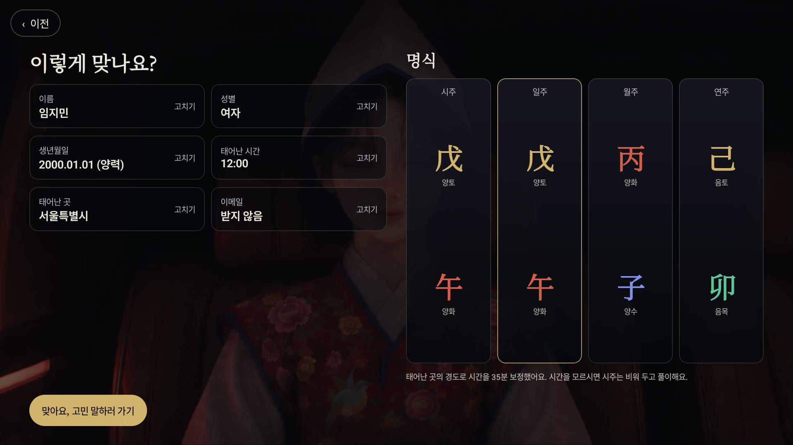
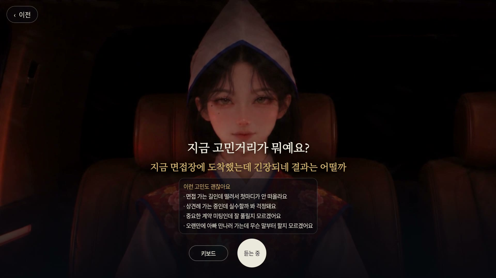
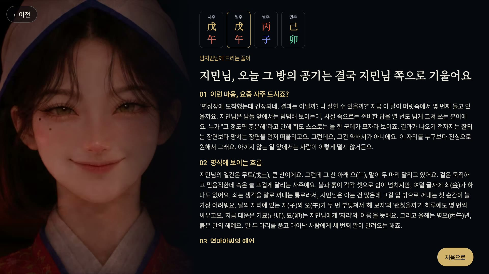
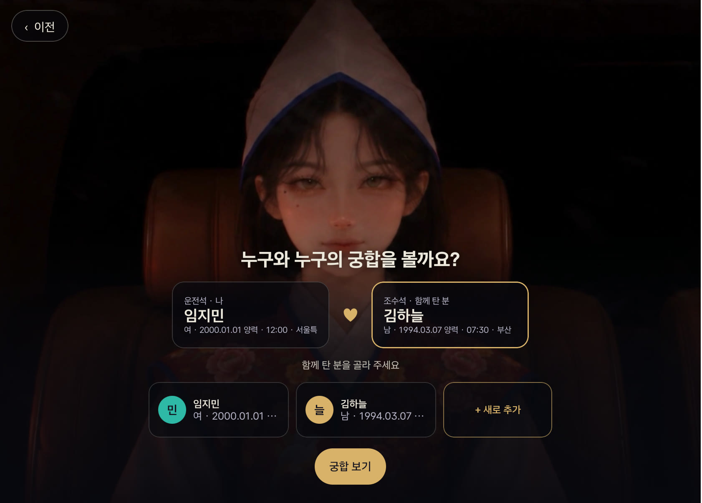
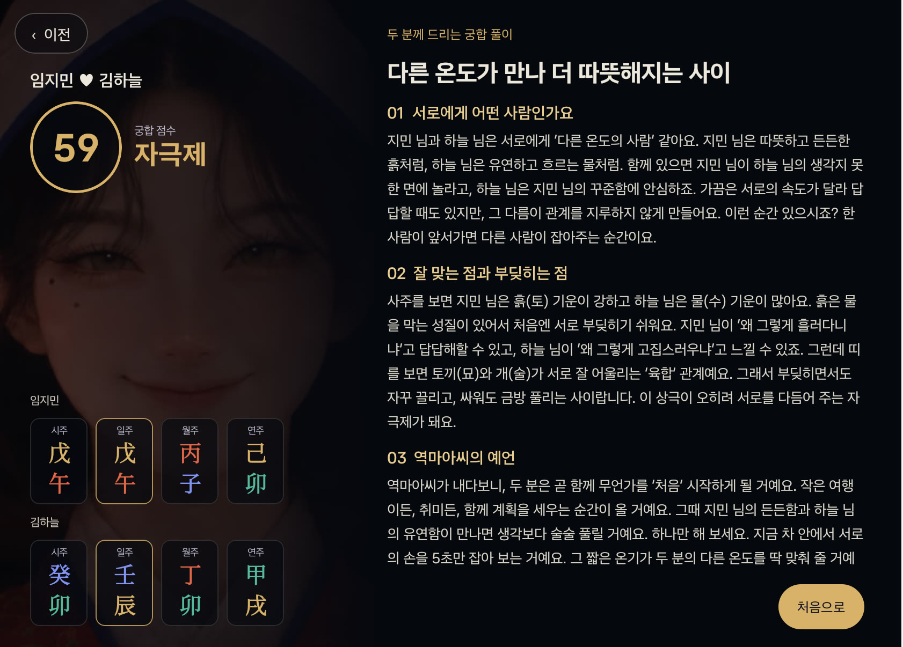

<p align="center">
  
</p>

<h1 align="center">역마사주 (Yeokma Saju)</h1>

<p align="center">팀 tridrive</p>

<p align="center"><b>중요한 일정을 앞두고, 출발 전이나 도착 후 차 안에서 보내는 몇 분. 그 시간의 고민을 사주로 풀어 주는 차량용 사주 앱</b></p>

<p align="center">
  <a href="#실행-방법">실행 방법</a> ·
  <a href="#apk">APK</a> ·
  <a href="#시연-영상">시연 영상</a> ·
  <a href="docs/기획서.md">기획서 (시나리오 · 개발 계획 · 기대효과 · 참고자료)</a>
</p>

중요한 일정이 있는 날에는 출발하기 전이나 도착한 뒤, 차 안에서 몇 분을 보내게 됩니다. 혼자 있을 수 있는 거의 유일한 공간이지만, 마음은 가장 불안한 때입니다. 역마사주는 그 몇 분을 위한 앱입니다.

앱을 열면 숲길을 달려온 차의 문이 열리고 역마아씨가 기다립니다. "탑승하기"를 누르는 순간 내 차의 앰비언트 라이트가 무드등 색으로 바뀌고 실내등이 켜지며, 송풍이 잔잔하게 흘러 영상 속 장면이 그대로 내 차 안으로 이어집니다. 지금의 고민을 말로 털어놓으면 역마아씨가 내 사주로 풀어 주고, 풀이를 기다리는 동안 무드등은 오행의 색으로 천천히 바뀝니다. 차는 화면이 달린 공간이 아니라, 중요한 자리에 들어가기 전 마음을 다잡게 해 주는 몰입 장치가 됩니다.

Pleos Connect(안드로이드 오토모티브) 차량용 앱입니다.

## 실행 방법

### 폴더

| 폴더 | 내용 |
|---|---|
| `app/` | 차량 앱. Kotlin, Jetpack Compose, Media3, Pleos Vehicle SDK 2.3.2, Pleos SpeechToText SDK 3.3.1 |
| `server/` | 서버. Rust. 이 컴퓨터에서 로컬로 실행하고, 포인트는 로컬 DB에 저장합니다 |
| `data/` | 태어난 곳 목록(전국 특별시·광역시와 시·군). 앱과 서버가 같이 씁니다 |

### 준비물

| 항목 | 버전 | 필요한 때 |
|---|---|---|
| Android Studio | 2026.2 이상 (명령줄 빌드에는 Android Studio에 들어 있는 JDK를 씁니다) | 앱 |
| Pleos 에뮬레이터 | Android SDK의 `pleos_car_emulator` 이미지 v2.1.0, 가상 기기 2560×1440 | 앱 |
| Rust | 1.100 이상 (`rustup`) | 서버 |
| Node.js | 24 이상 (`npx wrangler`) | 서버 |

### 1. 앱 설치와 실행

**서버를 켜지 않아도 앱은 끝까지 동작합니다.** 서버에 연결되지 않으면 앱 안의 목업 풀이(태어난 달의 계절 기운으로 쓴 풀이)가 나오고, 복채(포인트) 화면은 건너뜁니다. 정밀 만세력, 포인트, LLM 풀이를 보려면 2번의 서버를 켭니다.

#### 바로 설치 (빌드된 APK)

저장소의 [`apk/tridrive_yeokmasaju_release.apk`](apk/tridrive_yeokmasaju_release.apk)를 설치합니다. [Releases](https://github.com/hyndai-contest-team/yeokma-saju/releases/latest)에도 같은 파일이 있습니다. 빌드 없이 바로 됩니다.

```bash
export ANDROID_HOME="$HOME/Library/Android/sdk"

# 저장소 루트에서, 에뮬레이터를 켠 뒤 설치하고 실행합니다
$ANDROID_HOME/platform-tools/adb install -r --user 10 apk/tridrive_yeokmasaju_release.apk
$ANDROID_HOME/platform-tools/adb shell am start --user 10 -n com.yeokma.saju/.MainActivity
```

#### 직접 빌드해서 설치

```bash
export JAVA_HOME="/Applications/Android Studio.app/Contents/jbr/Contents/Home"
export ANDROID_HOME="$HOME/Library/Android/sdk"

# 에뮬레이터 켜기
$ANDROID_HOME/emulator/emulator -avd Pleos_Connect_v2.1.0 -no-snapshot-load &
$ANDROID_HOME/platform-tools/adb wait-for-device

# 빌드
cd app
./gradlew :app:assembleDebug

# 설치와 실행: Pleos 차량 화면은 사용자 10번이라 --user 10이 필요합니다
$ANDROID_HOME/platform-tools/adb install -r --user 10 app/build/outputs/apk/debug/app-debug.apk
$ANDROID_HOME/platform-tools/adb shell am start --user 10 -n com.yeokma.saju/.MainActivity
```

Android Studio에서는 `app/` 폴더를 열고 실행해도 됩니다.

- 앱은 서버를 `http://10.0.2.2:8787`(에뮬레이터에서 본 이 컴퓨터)로 찾습니다.
- 음성 입력은 Pleos SpeechToText SDK(3.3.1)의 `ON_DEVICE` 모드를 씁니다. 차 안의 인식 엔진이라 앱 등록 키가 필요 없습니다. 인식 엔진이 없는 기기에서는 키보드로 입력합니다.
- 공조 풍량·풍향 제어는 에뮬레이터가 지원하지 않아 실차에서만 동작합니다.

### 2. 서버 켜기 (선택)

정밀 만세력, 포인트, LLM 풀이를 보려면 이 컴퓨터에서 서버를 켭니다. Rust가 설치되어 있지 않다면 먼저 [Rust 설치 방법(macOS)](docs/rust-install-macos.md)을 따라 설치합니다.

```bash
cd server

# 처음 한 번
npx wrangler@4.162.0 d1 migrations apply yeokma-saju --local   # 로컬 포인트 DB 만들기

# (선택) LLM 키. 넣지 않으면 서버의 목업 풀이(실제 만세력으로 쓴 풀이)가 나옵니다
echo 'OPENROUTER_API_KEY="sk-or-..."' > .dev.vars

# 서버 실행 (에뮬레이터에서 붙을 수 있게 0.0.0.0)
npx wrangler@4.162.0 dev --ip 0.0.0.0 --port 8787
```

`http://127.0.0.1:8787/` 에서 `yeokma-saju api`가 보이면 켜진 것입니다.

- `.dev.vars`는 깃에 올라가지 않습니다. 키를 레포나 앱에 넣지 마세요.
- LLM 모델은 `wrangler.toml`의 `MODEL` 값 하나로 바꿉니다. 기본값은 `deepseek/deepseek-v4.1-flash-1017`(OpenRouter)입니다.
- 만세력 테스트: `cargo test --lib`

#### API

| 경로 | 하는 일 |
|---|---|
| `POST /api/manse` | 만세력 계산 |
| `GET /api/wallet?device=` | 포인트 잔액 |
| `POST /api/charge` | 포인트 충전. 시연용이라 결제 인증 없이 바로 충전됩니다 (990원 1회 / 9,900원 11회 / 99,000원 115회) |
| `POST /api/reading` | 990P를 먼저 빼고 풀이를 만듭니다. 포인트가 모자라면 402를 돌려주고 LLM을 부르지 않습니다 |
| `POST /api/match` | 두 사람의 궁합. 같은 방식으로 990P를 먼저 빼고 점수와 풀이를 만듭니다 |

## 테스트 환경 및 필요한 설정

| 설정 | 방법 |
|---|---|
| 에뮬레이터 실행 | Cold boot로 켠다(`-no-snapshot-load`). Quick boot로 켜면 차량 신호를 쓸 수 없다 |
| 설치·실행 사용자 | Pleos 차량 화면은 사용자 10번이다. `adb install --user 10`, `adb shell am start --user 10`처럼 `--user 10`을 붙인다 |
| 권한 | 차량 권한(`CAR_LIGHTS`, `CONTROL_CAR_LIGHTS`, `CAR_CLIMATE`, `CONTROL_CAR_CLIMATE`, `CAR_SEATS`, `STT_SERVICE`)은 설치하면 허용된다. 마이크 권한은 첫 음성 입력 때 묻는다 |
| 음성 입력 | Mac 마이크가 에뮬레이터에 들어가야 한다. 기본으로 켜져 있고, 안 되면 에뮬레이터 Extended controls → Microphone에서 "Virtual microphone uses host audio input"을 켠다. 키보드로도 입력할 수 있다 |
| 서버 | 없어도 앱은 끝까지 동작한다(앱 안 목업 풀이). 명식, 포인트, 궁합, LLM 풀이를 보려면 아래 "서버 켜기"대로 로컬 서버를 켠다. 앱은 `http://10.0.2.2:8787`로 찾는다 |
| 동승 궁합 | Virtual Console에서 조수석이나 뒷좌석을 "Occupied"로 바꾼 뒤 앱을 연다. `adb forward tcp:8088 tcp:8088` 후 `http://127.0.0.1:8088/` → Emulation Controls → Seat Occupancy |
| 앰비언트·실내등 확인 | Virtual Console의 Ambient 화면에서 앱이 바꾼 색과 실내등 상태를 볼 수 있다 |
| 처음 상태로 되돌리기 | `adb shell pm clear --user 10 com.yeokma.saju` (저장된 사람과 기기 번호가 지워진다) |
| 주행 중 잠금 | Virtual Console의 Test Console에서 기어를 D로 바꾸면 앱이 잠기고, P로 돌리면 보던 화면부터 이어진다 |
| 알려진 한계 | 공조 풍량·풍향은 에뮬레이터가 지원하지 않아 실차에서만 동작한다 |

테스트용 입력 예: 이름 "임지민", 성별 "여자", 생년월일 "2000년 1월 1일", 태어난 시간 "12시", 태어난 곳 "서울", 고민 "지금 면접장에 도착했는데 긴장되네. 나 잘할 수 있을까?". LLM 키 없이 서버를 켜면 이 사람에게는 시연용 풀이가 나온다.

## 개발 환경: Pleos Connect 에뮬레이터 버전과 화면 규격

| 항목 | 값 |
|---|---|
| 에뮬레이터 | Pleos Connect Emulator **v2.1.0** (Android Studio 시스템 이미지 `pleos_car_emulator`, arm64-v8a) |
| 안드로이드 | Android 14 (API 34) |
| 가상 기기(AVD) | `Pleos_Connect_v2.1.0`, Automotive, RAM 4GB, Cold boot |
| 화면 | **2560×1440**, 160dpi, 가로 |
| 앱이 그려지는 영역 | 차량 화면 오른쪽 칸, 약 1682×1206px (사용자 10번 화면) |
| 앱 설정 | `minSdk 34`, `targetSdk 34`, `compileSdk 37`, 가로 고정. 차량 화면에서 잘 보이게 UI를 1.45배로 키워 그린다 |
| 개발 PC | macOS, Apple Silicon (Pleos 에뮬레이터 이미지가 arm64라 Apple Silicon Mac에서 실행) |
| 시연 영상 녹화 | 앱을 전체 화면으로 담으려고 1920×1080 일반 안드로이드 에뮬레이터(Android API 37)에서 녹화. 동승 궁합 화면은 Pleos 에뮬레이터에서 촬영 |

## APK

| 항목 | 내용 |
|---|---|
| 저장소 안 위치 | [`apk/tridrive_yeokmasaju_release.apk`](apk/tridrive_yeokmasaju_release.apk) |
| GitHub Release | [최신 릴리스](https://github.com/hyndai-contest-team/yeokma-saju/releases/latest) |
| 파일 정보 | 패키지 `com.yeokma.saju`, 버전 0.1.0, 릴리스 빌드(코드 축소), 시연용 디버그 키 서명, 약 67MB |
| 직접 빌드한 경우 | `./gradlew :app:assembleRelease` → `app/app/build/outputs/apk/release/app-release.apk` |

## 시연 영상

https://github.com/user-attachments/assets/76b15628-df0b-4d45-a509-7a91ebe3bafa

시연용 영상입니다.

## 핵심 화면

### 사주 보기

<table>
  <tr>
    <td align="center" width="33%"><br><b>01 인트로 대기</b><br><sub>세로 한자와 함께 탑승을 기다립니다</sub></td>
    <td align="center" width="33%"><br><b>02 오셨군요</b><br><sub>저장된 사람을 고르거나 새로 추가</sub></td>
    <td align="center" width="33%"><br><b>03 말로 입력</b><br><sub>이름부터 태어난 곳까지 음성으로</sub></td>
  </tr>
  <tr>
    <td align="center" width="33%"><br><b>04 확인과 명식</b><br><sub>서버가 계산한 사주 여덟 글자</sub></td>
    <td align="center" width="33%"><br><b>05 지금 고민</b><br><sub>고민을 말로 털어놓습니다</sub></td>
    <td align="center" width="33%"><br><b>06 복채</b><br><sub>풀이 한 번 990P</sub></td>
  </tr>
  <tr>
    <td align="center" width="33%"><br><b>07 풀이 대기</b><br><sub>무드등이 오행 색으로 바뀝니다</sub></td>
    <td align="center" width="33%"><br><b>08 리포트</b><br><sub>명식과 역마아씨의 예언</sub></td>
    <td width="33%"></td>
  </tr>
</table>

### 동승 궁합

<table>
  <tr>
    <td align="center" width="33%"><br><b>09 혼자가 아니시군요?</b><br><sub>좌석 센서로 동승자 감지</sub></td>
    <td align="center" width="33%"><br><b>10 두 사람 고르기</b><br><sub>운전석과 함께 탄 분</sub></td>
    <td align="center" width="33%"><br><b>11 궁합 결과</b><br><sub>점수, 유형, 두 사람의 명식</sub></td>
  </tr>
</table>

## 기능

휴대폰과 다른 점은 사용자를 둘러싼 실제 공간까지 앱에 참여한다는 것입니다. 디스플레이에 역마아씨가 나타나고, 차량 스피커로 인사가 들리고, 앰비언트 라이트·실내등·송풍이 같은 장면을 함께 만듭니다.

| 구분 | 핵심 내용 |
|---|---|
| 디스플레이 · 스피커 | 숲길을 달려온 차와 역마아씨의 탑승 영상, 차량 스피커로 들리는 "오셨군요" 인사 |
| 앰비언트 라이트 · 실내등 | 대기 화면에서 무드등 금색과 실내등 켜기, 탑승 5초에 실내등 끄고 6초에 붉은빛, 풀이를 기다리는 동안 오행 색으로 순환 |
| 송풍 | 풍량 중간의 잔잔한 바람으로 몸으로도 느끼는 상담 분위기 |
| 음성 입력 | 이름, 성별, 생년월일, 태어난 시간("오후 한 시 반"), 태어난 곳(전국 시·군)을 질문에 따라 말로 입력. 키보드도 지원 |
| 저장된 사람 | 최대 5명까지 저장. 다시 오면 고르기만 하고 바로 고민으로 넘어가 일정 전의 짧은 시간을 아낍니다 |
| 명식 | 서버가 직접 계산한 사주 여덟 글자를 확인 화면과 리포트에 표시(절기, 음력·윤달, 진태양시, 한국 표준시·서머타임 이력, 대운, 십신, 지장간, 12운성, 공망, 합충) |
| 지금 고민 풀이 | 매번 "지금 고민거리가 뭐예요?"를 새로 묻고, 명식과 그날의 고민을 함께 반영해 제목과 소제목 3개로 풀이. 마지막은 "역마아씨의 예언" |
| 동승 궁합 | 좌석 센서로 동승자를 감지하면 "혼자가 아니시군요?"로 사주 보기와 궁합 보기를 나눔. 두 사람의 명식으로 점수(38\~97)와 유형(귀인, 단짝, 동반자, 자극제, 숙제) |
| 주행 중 잠금 | 기어가 P(주차)일 때만 쓸 수 있다. P를 벗어나면 화면을 잠그고 영상·소리·음성 입력을 멈추며, 바꿔 둔 조명과 공조를 바로 되돌린다. 다시 P에 두면 보던 화면부터 이어진다 |
| 평소 설정으로 복귀 | 연출 전에 기존 값을 저장해 두고, 앱을 떠나면 앰비언트 라이트·실내등·공조를 원래대로 되돌림 |

## 차량 특화 기능과 사용 SDK

| 기능 | 하는 일 | SDK · API | 권한 |
|---|---|---|---|
| 앰비언트 라이트 | 대기 화면에서 무드등 금색, 탑승 6초에 붉은빛, 풀이를 기다리는 동안 오행 색으로 바뀜 | Pleos Vehicle SDK 2.3.2 `Light`: `checkAmbientLightBrightnessColorCapabilities`, `getAmbientLightBrightnessColor`, `setAmbientLightBrightnessColor` | `CAR_LIGHTS`, `CONTROL_CAR_LIGHTS` |
| 실내등 | 대기 화면에서 켜고, 탑승 5초에 끔 | Vehicle SDK `Light`: `getCabinLightSwitch`, `setCabinLightSwitch` | `CAR_LIGHTS`, `CONTROL_CAR_LIGHTS` |
| 송풍 | 공조 전원을 켜고 AUTO·에어컨을 끈 뒤 풍량 중간, 얼굴 방향으로 잔잔한 바람 | Vehicle SDK `HVAC`: `setHvacPower`, `setHvacAuto`, `setHvacAc`, `setHvacFanSpeed`, `setHvacFanDirection` (각각 `check…Capabilities`, `get…`로 지원 범위와 원래 값 확인) | `CAR_CLIMATE`, `CONTROL_CAR_CLIMATE` |
| 주행 중 잠금 | 기어가 P가 아니면 화면을 잠그고 영상·소리·음성 입력을 멈춤, 조명·공조 복원 | Vehicle SDK `Gear`: `getCurrentGearSelectionState`, `registerGearSelection` | `CAR_DRIVE` |
| 동승자 감지 | 운전석 말고 앉은 자리가 있으면 "혼자가 아니시군요?"로 궁합 보기를 엶 | Vehicle SDK `Seat`: `checkSeatOccupancyCapabilities`, `getCurrentSeatOccupancy` | `CAR_SEATS` |
| 음성 입력 | 이름, 성별, 생년월일, 시간, 태어난 곳, 고민을 말로 입력 | Pleos SpeechToText SDK 3.3.1 (`ON_DEVICE` 모드): `initialize`, `setLocale(Locale.KOREA)`, `addListener`, `request`, `stop` | `STT_SERVICE` |

권한은 모두 `pleos.car.permission.` 아래 이름입니다. 바꾼 조명과 공조는 앱을 떠날 때 원래 값으로 되돌립니다.

## 사업성

| 근거 | 내용 |
|---|---|
| 시장 | 국내 점술 시장 약 **1조 4,000억 원** 추산(스타트업 분석 업체 추산, 2024) |
| 이미 검증된 앱 수요 | 대표 운세 앱 한 곳의 누적 다운로드 **1,700만 건**, 다른 한 곳의 가입자 **750만 명**(2026) |
| 폭넓은 고객층 | 성인 응답자의 **56.4%**가 사주 서비스를 이용해 본 경험이 있음(리서치 업체 조사). AI 사주 이용층은 30·40대 남성까지 넓어지는 중(2026). 중요한 일정을 앞둔 운전자라면 연령과 상관없이 고객입니다 |
| AI 사주의 급성장 | 한 AI 사주 앱의 월매출 **1천만 원대(2024) → 10억 원(2025)**, 월 이용자 **100만 명** 돌파(2026.08). 운세 앱 월 이용자 상위 10개 중 **6개가 AI 기능**을 갖춤(앱 분석 업체 집계, 2026) |
| 차별화가 필요한 이유 | 범용 AI 챗봇으로 운세를 보는 사람이 늘면서 텍스트 위주의 기존 운세 앱은 월 이용자가 전년보다 줄었음(대표 운세 앱 두 곳, 2026.01) |
| 역마사주의 자리 | 화면 속 텍스트로는 따라 할 수 없는 **차 안의 몰입 경험**(빛·바람·소리)과 **중요한 일정을 앞둔 출발 전·도착 후**라는 분명한 사용 순간. 중요한 일정이 생길 때마다 다시 여는 이유가 됩니다 |
| 수익 모델 | 풀이 1회 990P(990원). 9,900원 11회, 99,000원 115회 묶음. 동승 궁합도 같은 가격 |

예상 MAU와 매출 계산은 [기획서 6번 기대효과](docs/기획서.md#6-기대효과-및-발전-가능성)에 있습니다.

<sub>출처: [1](https://www.hankyung.com/article/2026021070861), [2](https://v.daum.net/v/20250909112824410), [3](https://blog.hanabank.com/501979), [4](https://v.daum.net/v/20260213173831600), [5](https://www.sedaily.com/article/20078817), [6](https://m.etnews.com/20260807000281), [7](https://www.kmjournal.net/news/articleView.html?idxno=8593), [8](https://www.sentv.co.kr/article/view/sentv202610230113)</sub>
