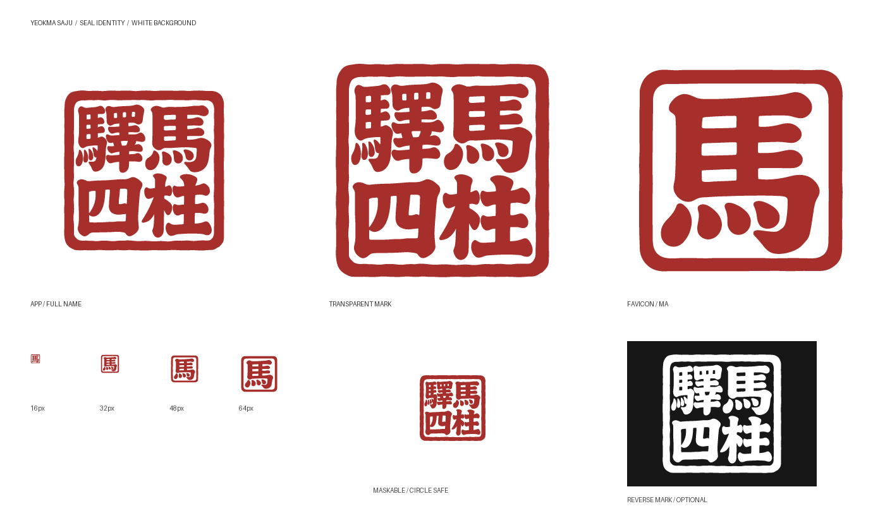

# 역마사주 로고

`驛馬四柱`를 두 줄로 새긴 사각 도장입니다. 기본 배경은 **순백색 `#FFFFFF`**, 인주는 **`#A62F2B`**입니다. 글자를 폰트가 아닌 벡터 경로로 저장해 폰트 설치 없이 확대하거나 사용할 수 있습니다.

| 윗줄 | 아랫줄 |
|---|---|
| 驛 馬 | 四 柱 |



## 바로 사용할 파일

| 용도 | 파일 |
|---|---|
| 기본 로고, 흰 배경 | [SVG](svg/yeokma-seal.svg), [1024px PNG](png/yeokma-seal-1024.png), [2048px PNG](png/yeokma-seal-2048.png) |
| 다른 화면이나 인쇄물에 얹기 | [투명 SVG 원본](svg/yeokma-seal-mark.svg), [투명 2048px PNG](png/yeokma-seal-transparent-2048.png) |
| 앱·스토어·프로필 | [512px PNG](app/app-icon-512.png), [1024px PNG](app/app-icon-1024.png), [SVG](svg/yeokma-app-icon.svg) |
| 단색 인쇄 | [검정 SVG](svg/yeokma-seal-monochrome.svg) |
| 어두운 화면용 보조 파일 | [흰 인주·투명 SVG](svg/yeokma-seal-reverse.svg), [PNG](png/yeokma-seal-reverse-1024.png) |
| 브라우저 파비콘 | [favicon.svg](web/favicon.svg), [favicon.ico](web/favicon.ico), 16·32·48px PNG |
| 웹 홈 화면·PWA | [apple-touch-icon.png](web/apple-touch-icon.png), 192·512px 아이콘 및 maskable 아이콘, [manifest](web/site.webmanifest) |
| Android | [리소스 묶음](android/res/), 이 레포의 `app/app/src/main/res/`에도 적용 |
| iOS·iPadOS | [AppIcon.appiconset](ios/AppIcon.appiconset/) — 흰 배경의 불투명 1024px 원본 |
| Windows·macOS | [ICO](desktop/app-icon.ico), [ICNS](desktop/app-icon.icns) |

모든 기본 앱·웹 아이콘은 흰 배경입니다. 투명·검정·흰 인주 파일은 다른 화면이나 인쇄에 쓰는 별도 보조 자산입니다. PNG는 sRGB 기준이며 인쇄소에서 CMYK를 요구하면 SVG를 가져가 해당 인쇄 프로파일로 변환합니다.

## 작은 아이콘

앱·로고에는 `驛馬四柱` 전체를 씁니다. 16·32px에서 네 글자가 뭉개지는 것을 줄이기 위해 파비콘에는 같은 도장 형태의 `馬` 한 글자를 사용합니다. [작은 도장 원본](svg/yeokma-monogram-mark.svg)은 파비콘·좁은 UI 전용 보조 마크입니다. 공식 앱 이름이나 네 글자 로고를 바꾸는 파일은 아닙니다.

## 적용

### Android / Pleos

앱 Manifest의 `android:icon`, `android:roundIcon`에 연결했습니다. 전경은 벡터, 배경은 흰색입니다. 108dp 레이어의 가운데에 도장을 배치해 원형·둥근 사각형 마스크에 여백을 둡니다. `monochrome` 레이어도 제공하며, 사용자가 테마 아이콘을 켠 경우 색은 운영체제 설정을 따릅니다. 기본 컬러 아이콘은 항상 흰 배경입니다.

다른 Android 프로젝트에서는 `android/res/`를 리소스 폴더에 복사하고 아래 속성을 `<application>`에 지정합니다.

```xml
android:icon="@mipmap/ic_launcher"
android:roundIcon="@mipmap/ic_launcher_round"
```

### 웹

`web/`의 파일을 사이트의 `/brand/`에 복사하고 [head.html](web/head.html)의 태그를 `<head>`에 넣습니다. 다른 경로를 쓰면 태그의 경로를 함께 바꿉니다. Manifest의 아이콘 경로는 Manifest 파일 기준 상대 경로입니다. 이 레포에는 웹 프런트엔드가 없으므로 파일과 연결 예제를 제공합니다.

### iOS / 데스크톱

iOS에서는 `AppIcon.appiconset`을 Asset Catalog로 가져오거나 `app/app-icon-1024.png`를 Single Size 원본으로 사용합니다. 데스크톱은 ICO 또는 ICNS를 사용합니다. 앱 아이콘 원본에는 외곽 마스크·그림자를 미리 굽지 않았습니다. 플랫폼이 모양을 적용하게 둡니다. 실제 빌드 검증 대상은 이 레포의 Android 앱입니다.

## 재생성

벡터 원본 두 개가 기준입니다. 기본 명령은 벡터를 보존하고 PNG·ICO·ICNS·Android 리소스만 다시 만듭니다.

```sh
python3 -m venv .venv
.venv/bin/pip install -r tools/brand-requirements.txt
.venv/bin/python tools/export_brand.py
```

원본 벡터의 경로를 편집한 뒤 같은 명령으로 내보냅니다. 생성 이미지부터 다시 벡터화할 때만 `--trace`를 붙입니다. 이 옵션은 두 벡터 원본을 덮어씁니다. `sources/`의 이미지는 제작 과정의 참고 원본이며 실제 적용에는 위의 최종 파일을 사용합니다.

[제작 방식과 프롬프트](sources/creation.md)

## 규격 참고

- [Android adaptive icons](https://developer.android.com/develop/ui/compose/system/icon_design_adaptive)
- [W3C Web App Manifest — icon masks](https://www.w3.org/TR/appmanifest/#icon-masks)
- [Apple — Configuring your app icon using an asset catalog](https://developer.apple.com/documentation/xcode/configuring-your-app-icon)
