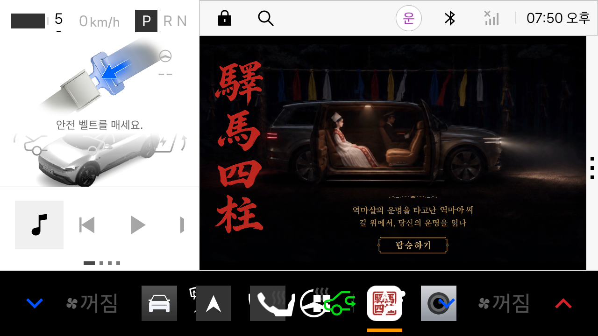
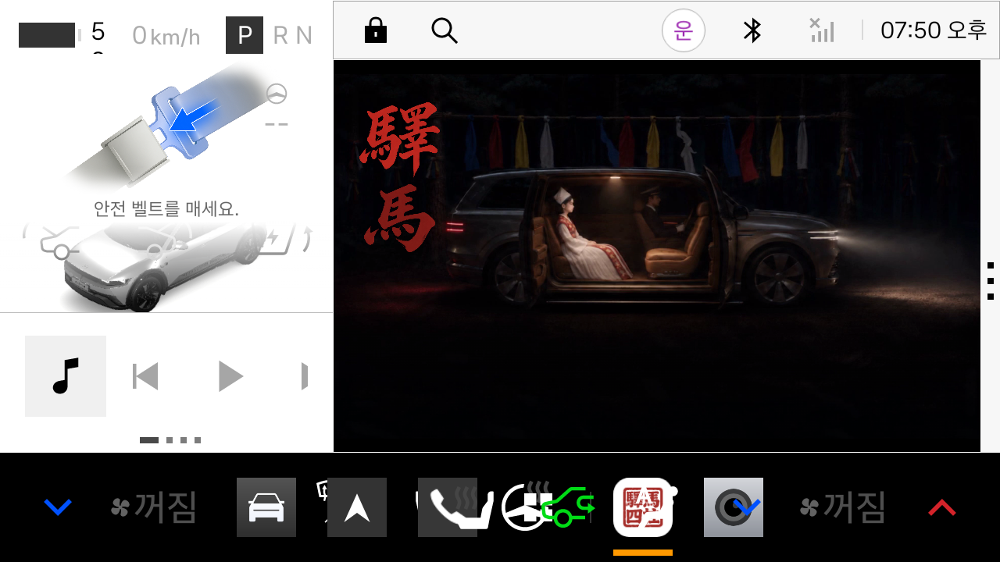

# 인트로 대기 화면

V1 도입 영상이 끝나거나 건너뛰기를 누른 뒤의 V2 대기 화면에 적용한다.

- 붉은 붓글씨 `驛馬四柱`를 왼쪽에 세로로 배치한다.
- PNG를 IO 스레드에서 읽어 준비한 뒤 등장 순서를 시작한다.
- 제목은 180ms 후부터 310ms 간격으로 한 글자씩 680ms 동안 페이드인한다.
- 소개 문구, 매듭, 테두리와 버튼 글씨는 1,950ms 후부터 600ms 동안 함께 나타난다.
- 버튼은 등장 완료 후 활성화되며, 최소 터치 영역은 48dp다.
- 16:9 무대 전체를 화면 안에 맞춰 제목과 버튼이 잘리지 않게 한다.

PNG는 `app/app/src/main/res/drawable-nodpi/intro_*.png`에 있다. 제목 4개, 소개 문구 14개, 설명 13개(쉼표 포함), 버튼 글자 4개, 장식 2개로 총 37개다. 글자마다 독립적인 알파 채널을 갖는다.

`layout.json`은 1920×1080 기준 배치와 파일 매핑이다. 경로는 저장소 루트 기준이고, 글자별 `x/y/width/height`는 문구 안의 좌표다. 원본 픽셀 크기가 배치 크기와 다른 글자는 `assetWidth/assetHeight`도 갖는다. 앱의 같은 배치는 `IntroArtworkData.kt`에 있다.

## 화면

아래는 Pleos Connect Android 14 에뮬레이터의 실제 실행 화면이다. 시스템의 분할 화면 안에서도 16:9 전체 구도를 유지한다.

## 검증

- `:app:assembleDebug :app:lintDebug` 통과.
- Pleos Connect v2.1.0 / Android 14 / 1280×720에서 `건너뛰기 → V2 대기 → 탑승하기 → V3 → 저장된 사람 선택` 흐름을 확인했다.
- UI 계층에서 탑승 버튼의 클릭 가능 상태와 최소 터치 영역을 확인했다.
- 35개 글자 PNG의 순서·투명 채널과 2개 장식 PNG를 확인했다.

변경 범위는 V2 대기 화면이다. V1·V3·V4 영상, 이후 입력 흐름, 차량 연출과 서버는 기존 코드를 사용한다.
