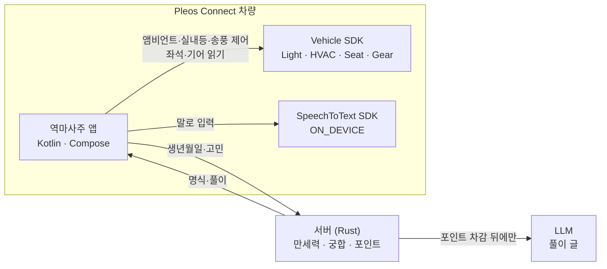

# 역마사주 기획서

## 1. 앱 한 줄 소개

중요한 일정을 앞두고 출발 전이나 도착 후 차 안에서 보내는 몇 분, 그 시간의 고민을 사주로 풀어 주는 차량용 사주 앱이다.

## 2. 기획 배경

중요한 일정을 앞두고 차 안에서 기다리다 보면 "오늘 잘할 수 있을까" 하는 걱정이 든다. 누군가에게 연락해 꺼내기에는 애매하지만, 혼자 생각하다 보면 긴장이 더 커지기도 한다. 그 몇 분 동안 고민을 말하고 내 사주에 비춰 풀어 보면 어떨까 하는 생각에서 역마사주를 기획했다. 역마아씨와 잠깐 이야기를 나누고, 조금은 가벼운 마음으로 차에서 내려 약속 자리에 들어갈 수 있기를 바랐다.

휴대폰 운세 앱은 오늘의 띠별 운세처럼 넓은 이야기만 하고 지금 이 고민에는 답하지 않는다. 작은 화면을 들여다보는 일이라 긴장을 풀어 주지도 못한다. 역마사주는 차 안 전체를 상담 공간으로 바꿔, 지금의 고민을 내 사주로 풀어 준다.

## 3. 앱 주요 기능 및 차량 특화 요소

| 구분 | 핵심 내용 |
|---|---|
| 디스플레이 · 스피커 | 탑승 영상과 영상 속 소리로 역마아씨를 만나는 장면 연출 |
| 앰비언트 라이트 · 실내등 | 상담 단계에 맞춰 색과 켜짐 상태를 바꾸는 실내 연출 |
| 송풍 | 실제 바람을 더해 몸으로도 느끼는 상담 분위기 |
| 좌석 센서 | 함께 탄 사람을 알아채 사주 보기와 궁합 보기로 나눔 |
| 기어 | P일 때만 열리고, 주행 중에는 잠그고 차량 설정을 되돌림 |
| 음성 입력 | 사주 정보와 지금의 고민을 질문에 따라 말로 입력 |
| 개인 사주 풀이 | 서버가 직접 계산한 명식과 현재 고민을 함께 반영한 풀이 |

### 차 안에서만 경험할 수 있는 몰입형 사주 상담

역마사주는 차량의 디스플레이, 스피커, 앰비언트 라이트, 실내등, 송풍을 함께 사용해 사용자가 앉아 있는 차 안을 역마아씨의 상담 공간으로 바꾼다. 화면에 보이는 장면과 함께 주변의 소리, 실내의 빛과 바람도 달라진다. 사용자는 별도의 장비를 착용하지 않고 평소 앉던 좌석에서 상담에 들어간다.

휴대폰과 구별되는 부분은 사용자를 둘러싼 실제 공간까지 앱에 참여한다는 점이다. 이 차량 기능은 화면을 꾸미는 단순한 연출이 아니라, 실제로 역마아씨를 찾아가 마주 앉은 듯한 느낌을 주는 핵심 몰입 요소다.

### 탑승부터 상담까지 이어지는 차량 연출

- 앱을 실행하면 숲길과 문이 열린 차량, 그 안에서 기다리는 역마아씨가 등장한다. 대기 화면에서는 실제 실내등을 켜고 앰비언트 라이트를 황금빛으로 바꾸며 송풍을 작동시킨다.
- "탑승하기"를 누르면 시점이 영상 속 차량 안으로 이동한다. 탑승 장면이 진행되면 실제 실내등이 꺼지고 앰비언트 라이트가 붉은빛으로 바뀐다. 이어 차량 스피커로 영상에 담긴 역마아씨의 인사가 들린다.
- 풀이를 기다리는 동안에는 역마아씨가 있는 화면을 유지하고 앰비언트 라이트를 오행을 나타내는 색으로 차례로 바꾼다.

### 질문에 말로 답하는 사주 정보 입력

- 이름, 성별, 생년월일, 태어난 시간과 장소를 한 화면에서 하나씩 묻는다. 말로 답하면 내용을 입력하고 다음 질문으로 넘어간다. 태어난 시간은 "오후 한 시 반"처럼 답할 수 있고, 태어난 곳은 전국 시·군 목록으로 알아듣고 같은 이름이 여러 곳이면 다시 묻는다.
- 입력한 정보는 확인 화면에서 명식과 함께 살펴보고 고칠 수 있다. 키보드 입력도 지원한다.
- 입력한 사람은 최대 5명까지 저장한다. 다시 오면 저장된 사람을 고르고 곧바로 고민을 이야기할 수 있어 일정 전의 짧은 시간을 아낀다.

### 중요한 일정을 앞둔 지금의 고민을 푸는 사주 상담

- 기본 정보를 확인한 뒤 "지금 고민거리가 뭐예요?"라고 묻는다. 사용자는 "면접에서 긴장해서 말을 못 할까 봐 걱정돼요", "오늘 미팅에서 제안을 어떻게 꺼내야 할지 모르겠어요"처럼 자신이 처한 상황을 이야기한다.
- 생년월일과 태어난 시간·장소로 계산한 명식에 현재 고민을 함께 반영해 풀이를 작성한다. 결과는 제목과 소제목 셋으로 나누고, 마지막은 "역마아씨의 예언"으로 맺는다.
- 같은 사용자가 다시 찾아와도 그날의 고민을 새로 묻는다.

### 함께 탄 사람과 보는 동승 궁합

- 좌석 센서로 운전석 말고 앉은 자리가 있으면 "혼자가 아니시군요?"를 묻고 사주 보기와 궁합 보기로 나눈다.
- 궁합은 두 사람의 명식으로 점수와 유형(귀인, 단짝, 동반자, 자극제, 숙제)을 계산하고, 서로에게 어떤 사람인지와 역마아씨의 예언을 보여 준다.

### 안전과 평소 설정으로 복귀

- 기어가 P일 때만 쓸 수 있다. P를 벗어나면 화면을 잠그고 영상·소리·음성 입력을 멈춘다. 다시 P에 두면 보던 화면과 그 화면의 조명·공조가 이어진다. 기어 값을 알 수 없으면 잠근다.
- 차량 연출을 시작하기 전에 기존 설정을 저장하고, P를 벗어나거나 앱이 화면에서 사라지면 바꿨던 앰비언트 라이트·실내등·공조 설정을 되돌린다.
- 차량 장치는 차종이 지원하는 기능과 영역에 맞춰 사용한다. 송풍의 풍량·풍향은 실차 확인을 거쳐 조정할 계획이다.

### 왜 차인가: 몰입에는 차가 가장 중요한 환경이다

사주 풀이가 마음에 닿으려면 듣는 사람이 그 순간에 온전히 빠져들어야 한다. 휴대폰은 손안의 작은 화면뿐이고 알림과 주변 소음에 쉽게 끊긴다. 차는 다르다. 문을 닫으면 바깥과 분리된 나만의 공간이 되고, 화면·스피커·빛·바람이 몸 전체를 감싼다. 역마사주는 이 차 안을 통째로 역마아씨의 상담 공간으로 바꾼다. **이 몰입은 차 안에서만 만들 수 있다.**

| 근거 | 내용 |
|---|---|
| 사람들은 이미 차 안에서 마음을 준비한다 | 운전자 2,000명 조사에서 26%가 집이나 직장에 들어가기 전 마음을 준비하려고 차 안에서 시간을 보내고, 77%가 출발·도착 전후의 "카타임"을 즐긴다고 답했다[1]. 다른 조사에서는 63%가 차 안에서 5분 쉬고 나면 하루를 더 잘 준비한다고 느꼈다[2]. 국내 조사에서도 혼자만의 공간이 필요할 때 떠올리는 곳으로 자동차가 꼽혔다(16.9%)[3] |
| 차 안의 빛은 감정을 움직인다 | 차량 실내조명의 색을 바꾸면 뇌파로 측정한 각성도가 달라졌고[4], 앰비언트 조명을 켜면 운전자의 수행이 나아졌다[5]. 운전자의 감정에 맞춰 조명을 바꿔 스트레스를 낮추는 연구도 진행되고 있다[6] |
| 차는 감각 전체를 한꺼번에 바꿀 수 있는 유일한 개인 공간이다 | 고급차 브랜드는 이미 공조·향기·시트 마사지·음악·앰비언트 조명을 묶어 기분을 바꾸는 프로그램을 판매하고 있다[7]. 현대차그룹도 플레오스 커넥트 앱 마켓을 게임·엔터테인먼트 앱으로 넓힐 계획이다[8] |
| 플레오스가 가려는 방향과 맞는다 | 역마사주는 차 기능을 함께 움직여 몰입을 만드는 차량 전용 엔터테인먼트 앱이다. 앱 마켓이 엔터테인먼트로 넓어질 때 휴대폰 앱을 옮겨 온 것이 아니라 **차에서만 할 수 있는 콘텐츠**가 필요하고, 역마사주는 그 첫 사례가 될 수 있다. 중요한 일정이 생길 때마다 다시 여는 이유가 있어 앱 마켓의 재방문도 만든다 |

역마사주는 이 근거 위에서 차의 디스플레이·스피커(탑승 영상과 인사), 앰비언트 라이트·실내등(장면마다 바뀌는 빛), 송풍(잔잔한 바람), 좌석 센서(함께 탄 사람)를 하나의 장면으로 묶는다.

출처: [1](https://www.halfordscompany.com/news-and-media/news/brits-spend-half-a-day-a-year-in-their-cars-searching-for-peace-and-quiet/) 영국 운전자 조사(업체 의뢰), [2](https://www.nova.ie/motorists-spend-more-than-three-days-of-their-lives-looking-for-their-cars/) 아일랜드 운전자 조사, [3](https://www.openads.co.kr/content/contentDetail?contsId=1579) 국내 소비자 조사, [4](https://deepai.org/publication/affective-responses-to-chromatic-ambient-light-in-a-vehicle) Kim 외(2022), [5](https://dl.ifip.org/IFIP-LNCS-11746/hal-02544538) Hassib 외(INTERACT 2019), [6](https://openaccess.cms-conferences.org/publications/book/978-1-958651-15-5/article/978-1-958651-15-5_47) AHFE 2022, [7](https://www.mercedes-benz.co.nz/passengercars/brand/mercedes-me-magazine/innovation/articles/ergonomic-design-driving-comfort.html) 제조사 기능 소개, [8](https://www.hyundaimotorgroup.com/en/news/hyundai-motor-group-redefines-in-vehicle-experience-with-pleos-connect-next-generation-infotainment-system) 현대차그룹 발표

### 휴대폰 운세 앱·AI 챗봇과 다른 점

| | 휴대폰 운세 앱 | 범용 AI 챗봇 | 역마사주 |
|---|---|---|---|
| 언제 쓰나 | 아무 때나 | 아무 때나 | 중요한 일정을 앞둔 출발 전·도착 후의 몇 분 |
| 무엇에 답하나 | 띠별·오늘의 운세 | 묻는 대로 | 내 명식과 지금 말한 고민을 함께 |
| 사주 계산 | 앱마다 다름 | 계산 근거가 없음 | 서버가 직접 계산(진태양시, 절기, 대운 등) |
| 어디서 겪나 | 손안의 작은 화면 | 텍스트 | 차 디스플레이·스피커·앰비언트 라이트·실내등·송풍 |
| 입력 | 키보드 양식 | 키보드 | 질문에 말로 답하기 |
| 함께 탄 사람 | 모름 | 모름 | 좌석 센서로 알아채 궁합으로 연결 |
| 안전 | 해당 없음 | 해당 없음 | 기어가 P일 때만 열림, 주행 중 잠금 |

## 4. 주요 사용 시나리오

### 시나리오 1. 면접 15분 전, 혼자

1. 면접 보는 회사 주차장에 도착했다. 들어가기까지 15분이 남았다.
2. 역마사주를 연다. 숲길을 달려온 차의 문이 열리고 역마아씨가 기다린다. 이때 실내 앰비언트 라이트가 금색으로 바뀌고 실내등이 켜지고, 송풍구에서 약한 바람이 나온다.
3. "탑승하기"를 누른다. 화면 속 시점이 차 안으로 들어가고, 5초쯤 실제 실내등이 꺼지고 앰비언트가 붉게 바뀐다. 스피커로 "오셨군요"가 들린다.
4. 처음이라 정보를 말로 입력한다. "임지민", "여자예요", "이천 년 일월 일일이요", "열두 시요", "서울이요". 1분이 채 안 걸린다.
5. 확인 화면에 입력한 정보와 함께 명식(戊午 일주 등 여덟 글자)이 나온다.
6. "지금 고민거리가 뭐예요?"에 "지금 면접장에 도착했는데 긴장되네. 나 잘할 수 있을까?"라고 말한다.
7. 풀이를 기다리는 몇 초 동안 앰비언트가 오행의 색으로 바뀐다.
8. 풀이가 나온다. 마지막 소제목 "역마아씨의 예언"은 첫 질문에서 목소리가 떨려도 두 번째 질문부터 분위기가 넘어온다고 내다보고, 내리기 전에 숨을 네 번 고르고 첫 문장을 소리 내 보라고 권한다.
9. 앱을 닫으면 조명과 공조는 원래 설정으로 돌아간다. 그대로 기어를 바꿔 출발해도 P를 벗어나는 순간 원래대로 돌아간다.

### 시나리오 2. 소개팅 장소에 도착해서, 친구와 함께

1. 친구를 태우고 소개팅 장소 앞에 도착해 기어를 P에 두었다. 운전석에 본인, 조수석에 친구가 앉아 있다. 앱을 열고 탑승하면 좌석 센서가 조수석 탑승을 감지한다.
2. "어라, 혼자가 아니시군요?"가 뜨고 "사주 보기"와 "궁합 보기" 중 고른다.
3. 궁합 보기를 고르고 저장된 두 사람을 운전석과 조수석 자리에 넣는다.
4. 두 사람의 명식으로 계산한 점수(예: 59점)와 유형(귀인, 단짝, 동반자, 자극제, 숙제 중 하나), 서로에게 어떤 사람인지, 잘 맞는 점과 부딪히는 점, 그리고 역마아씨의 예언이 나온다.
5. 같은 화면을 함께 보며 들어가기 전까지 이야기를 나눈다.

### 시나리오 3. 다시 찾을 때

- 저장된 사람(최대 5명)을 누르면 입력 없이 바로 고민 질문으로 간다.
- 고민은 매번 새로 묻는다. 면접 날과 상견례 날에 각각 그날에 맞는 풀이를 받는다.
- 포인트가 남아 있으면 결제 화면 없이 바로 풀이로 넘어간다.

## 5. 개발 계획

### 구현 범위 (현재 완료)

| 영역 | 내용 |
|---|---|
| 앱 | Kotlin, Jetpack Compose. 인트로 영상 4편(도입, 대기 루프, 탑승, 대기 화면 배경), 음성 입력 6단계, 확인과 명식, 고민, 복채, 풀이 대기, 리포트, 동승 궁합 |
| 차량 연출 | 앰비언트 라이트, 실내등, 송풍. 연출 전 원래 값을 읽어 두고 앱을 떠나면 되돌린다. 차종마다 지원 범위가 달라 capability 함수로 지원 영역을 확인한 뒤 해당 항목만 제어한다 |
| 음성 입력 | Pleos SpeechToText `ON_DEVICE`. Pleos 인식 엔진이 없는 기기에서는 안드로이드 기본 음성 인식기로, 그것도 없으면 키보드로 받는다. 한글 숫자 시각("십삼 시"), 지명 문장("광주에서 태어났어"), 성별 표현("여성이에요", "남자") 처리. 태어난 곳은 전국 특별시·광역시와 시·군 목록으로 판별하고 같은 이름이 여러 곳이면 되묻는다 |
| 서버 | Rust. 만세력(절기, 음력·윤달, 진태양시, 한국 표준시·서머타임 이력, 대운, 십신, 지장간, 12운성, 공망, 합충)을 직접 계산한다. 포인트를 먼저 차감한 뒤에만 LLM을 호출하고, 실패하면 환불한다 |
| 주행 중 잠금 | 기어가 P일 때만 쓸 수 있다. P를 벗어나면 화면을 잠그고 영상·소리·음성 입력을 멈추며, 바꿔 둔 조명과 공조를 바로 되돌린다. 다시 P에 두면 보던 화면과 그 화면의 조명·공조가 이어진다. 기어 값을 알 수 없으면 잠근다 |
| 궁합 | 일간 오행의 상생·상극, 천간합, 일지·띠의 육합·삼합·충, 서로 비어 있는 오행을 채워 주는지로 점수를 계산한다 |

### 사용 SDK와 API

| 기능 | SDK · API | 권한 | 코드 |
|---|---|---|---|
| 앰비언트 라이트 | Vehicle SDK 2.3.2 `Light`: `checkAmbientLightBrightnessColorCapabilities`, `getAmbientLightBrightnessColor`, `setAmbientLightBrightnessColor` | `CAR_LIGHTS`, `CONTROL_CAR_LIGHTS` | [CarMood.kt `ambient`](../app/app/src/main/java/com/yeokma/saju/car/CarMood.kt#L99), [오행 순환](../app/app/src/main/java/com/yeokma/saju/ui/ReadingScreens.kt#L128) |
| 실내등 | Vehicle SDK `Light`: `getCabinLightSwitch`, `setCabinLightSwitch` | `CAR_LIGHTS`, `CONTROL_CAR_LIGHTS` | [CarMood.kt `cabin`](../app/app/src/main/java/com/yeokma/saju/car/CarMood.kt#L110), [탑승 5초](../app/app/src/main/java/com/yeokma/saju/intro/IntroFlow.kt#L107) |
| 송풍 | Vehicle SDK `HVAC`: `setHvacPower`, `setHvacAuto`, `setHvacAc`, `setHvacFanSpeed`, `setHvacFanDirection` | `CAR_CLIMATE`, `CONTROL_CAR_CLIMATE` | [CarMood.kt `breeze`](../app/app/src/main/java/com/yeokma/saju/car/CarMood.kt#L118) |
| 주행 중 잠금 | Vehicle SDK `Gear`: `getCurrentGearSelectionState`, `registerGearSelection` | `CAR_DRIVE` | [CarMood.kt 기어 구독](../app/app/src/main/java/com/yeokma/saju/car/CarMood.kt#L50), [잠금 화면](../app/app/src/main/java/com/yeokma/saju/SajuApp.kt#L319) |
| 동승자 감지 | Vehicle SDK `Seat`: `checkSeatOccupancyCapabilities`, `getCurrentSeatOccupancy` | `CAR_SEATS` | [CarMood.kt `companions`](../app/app/src/main/java/com/yeokma/saju/car/CarMood.kt#L61) |
| 음성 입력 | SpeechToText SDK 3.3.1: `initialize`, `setLocale`, `addListener`, `request`, `stop` | `STT_SERVICE` | [Voice.kt](../app/app/src/main/java/com/yeokma/saju/input/Voice.kt#L39) |

권한 이름은 모두 `pleos.car.permission.`으로 시작한다.

### 구조

### 앞으로 할 일

| 시기 | 내용 |
|---|---|
| 실차 검증 | 송풍 풍량·풍향은 에뮬레이터가 지원하지 않아 실차에서 확인하고 조정한다. 좌석 점유 값의 방향(SDK 2.3.2에서 빈 자리가 true)도 실차에서 다시 확인한다 |
| 음성 출력 | 역마아씨가 풀이를 읽어 주도록 Gleo TextToSpeech를 붙인다 |
| 결제 | 지금은 시연용 즉시 충전이다. 앱 마켓 결제 정책에 맞춰 실제 결제를 연동한다 |
| 해외 | 플레오스 커넥트의 북미·유럽 확대 시점에 맞춰 영어 풀이와 사주 설명을 준비한다 |

## 6. 기대효과 및 발전 가능성

### 사용자 가치

- 중요한 일정을 앞둔 출발 전·도착 후의 몇 분을, 혼자 불안해하는 시간에서 마음을 정리하는 시간으로 바꾼다.
- 풀이 끝에 지금 차 안에서 해 볼 행동 하나를 준다. 결과가 좋은 쪽으로 이어지도록 마음을 다잡게 한다.
- 함께 탄 사람과 관계 이야기를 꺼낼 계기가 생긴다.

### 시장

| 항목 | 내용 |
|---|---|
| 국내 점술 시장 | 약 1조 4,000억 원 (2024년 추산) |
| 온라인 사주 | 대표 운세 앱 한 곳은 누적 다운로드 1,700만 건, 다른 한 곳은 가입자 750만 명 (2026) |
| AI 사주 | 한 AI 사주 앱의 월매출이 1천만 원대(2024)에서 10억 원(2025)으로 늘었고, 월 이용자 100만 명을 넘었다 (2026.08). 운세 앱 월 이용자 상위 10개 중 6개가 AI 기능을 갖췄다 (2026) |
| 이용 경험 | 성인 응답자의 56.4%가 사주 서비스를 이용해 본 적이 있다. 이용층은 30·40대 남성까지 넓어지고 있다 |
| 플랫폼 방향 | 현대차그룹은 2030년까지 플레오스 커넥트 탑재 차량 약 2,000만 대를 확보하고 앱 마켓을 게임·엔터테인먼트로 넓힐 계획이다. 역마사주는 그 엔터테인먼트 영역에 들어갈 차량 전용 콘텐츠다 |
| 경쟁 상황 | 범용 AI 챗봇으로 운세를 보는 사람이 늘면서 텍스트 위주 운세 앱은 월 이용자가 전년보다 줄었다 (2026.01). 차 안의 빛·바람·소리를 쓰는 몰입 경험은 휴대폰 앱과 챗봇이 따라 할 수 없다 |

### 타깃 고객

- 1차: 결과가 마음에 걸리는 중요한 일정을 앞두고, 출발 전이나 도착 후 차 안에서 몇 분을 보내는 운전자. 연령을 가리지 않는다.
- 2차: 가족, 연인, 친구, 동료와 함께 타는 운전자 (동승 궁합).

### 예상 MAU

플레오스 커넥트 탑재 차량 수에서 출발해 단계별로 줄여 계산했다.

**1단계. 국내 탑재 차량 수**

| 근거 | 수치 |
|---|---|
| 그룹 목표 | 2030년까지 플레오스 커넥트 탑재 차량 약 2,000만 대 (현대·기아·제네시스, 전 세계) |
| 현재 | 2026년 5월 더 뉴 그랜저부터 국내 적용. 그랜저 5\~10월 판매 약 4만 3,700대. 하반기 아반떼로 확대 |
| 국내 비중 | 현대차·기아 연간 판매 약 727만 대(2025) 중 국내 약 125만 대, 약 17% |

국내 비중 17%를 2,000만 대에 적용하면 2030년 국내 탑재 차량은 약 340만 대다. 차종이 순차적으로 바뀌는 점을 반영해 연도별 누적을 아래처럼 잡았다(추정).

| 연도 | 2026 | 2027 | 2028 | 2029 | 2030 |
|---|---|---|---|---|---|
| 국내 누적 탑재 차량 | 약 7만 | 50만 | 120만 | 220만 | 340만 |

**2단계. 이용 가능 차량에서 MAU까지**

| 단계 | 비율 | 근거 |
|---|---|---|
| 순정 인포테인먼트 사용 | 73% | 국산차 보유자 중 순정 시스템 사용 비율 (컨슈머 조사) |
| 앱 설치 | 2% → 6% | 가정. 2027년 2%에서 2030년 6%로 증가. 차량 앱 마켓 초기라 경쟁 앱이 적다 |
| 월 활성 | 35% | 가정. 중요한 일정이 있는 달에 여는 앱이라 매달 쓰지는 않는다 |

**3단계. 결과 (기본 시나리오)**

| 연도 | 국내 탑재 차량 | 설치 차량 | MAU |
|---|---|---|---|
| 2027 | 50만 | 7,300 | 약 2,600 |
| 2028 | 120만 | 3만 700 | 약 1만 700 |
| 2029 | 220만 | 8만 300 | 약 2만 8,100 |
| 2030 | 340만 | 14만 8,900 | 약 5만 2,100 |

2030년 시나리오별 MAU (국내)

| 시나리오 | 설치율 | 월 활성 | MAU |
|---|---|---|---|
| 보수 | 3% | 25% | 약 1만 8,600 |
| 기본 | 6% | 35% | 약 5만 2,100 |
| 낙관 | 10% | 45% | 약 11만 1,700 |

해외 탑재 차량(약 1,660만 대)은 계산에 넣지 않았다. 영어 풀이를 준비하면 추가 성장분이 된다.

### 재이용률과 매출

- 재이용률: 월 재방문 35%를 가정했다(월 활성 비율과 같다). 저장된 사람과 매번 새로 묻는 고민이 재방문 이유다.
- 결제: 풀이 1회 990원, 묶음 9,900원(11회), 99,000원(115회). MAU의 60%가 한 달 평균 1.5회 풀이를 산다고 가정하면 MAU 1명당 월 약 890원이다.
- 2030년 기본 시나리오 연매출: 약 5만 2,100명 × 890원 × 12개월 = 약 5억 6천만 원 (국내만).

### 확대 계획

| 단계 | 내용 |
|---|---|
| 1단계 | 국내 출시. 혼자 보는 고민 풀이, 동승 궁합, 포인트 결제 |
| 2단계 | 역마아씨 음성(TTS)으로 풀이 낭독, 일정 앱·내비 목적지와 연동해 중요한 일정 도착 시 먼저 제안 |
| 3단계 | 플레오스 커넥트의 북미·유럽 확대에 맞춰 영어 풀이. 신년 운세, 길일 같은 시즌 콘텐츠 |

## 7. 참고자료

| 자료 | 위치 |
|---|---|
| GitHub 저장소 | https://github.com/hyndai-contest-team/yeokma-saju |
| 시연 영상 | 저장소 README 맨 위 (1080p 원본: `docs/demo/yeokma-demo.mp4`) |
| APK | 저장소의 `apk/tridrive_yeokmasaju_release.apk`, 또는 https://github.com/hyndai-contest-team/yeokma-saju/releases/latest |
| 주요 화면 | [상세 README](상세_README.md)의 "핵심 화면", 원본은 `docs/screenshots/` |

저장소가 비공개라 제출 전에 공개로 바꾸거나 심사용 접근 방법을 정해야 한다.

## 출처

- 플레오스 커넥트 2,000만 대 목표, 그랜저 첫 적용: [현대자동차그룹](https://www.hyundaimotorgroup.com/ko/story/pleos-connect-next-generation-infotainment-system), [Hyundai Motor Group 보도자료](https://www.hyundaimotorgroup.com/en/news/hyundai-motor-group-redefines-in-vehicle-experience-with-pleos-connect-next-generation-infotainment-system)
- 그랜저 월별 판매: [나무위키 그랜저 7세대](https://namu.wiki/w/%ED%98%84%EB%8C%80%20%EA%B7%B8%EB%9E%9C%EC%A0%80/7%EC%84%B8%EB%8C%80) (2차 집계), [10월 판매 기사](https://m.news.nate.com/view/20261102n26995)
- 현대차 2025년 연간 판매: [현대자동차그룹](https://www.hyundaimotorgroup.com/ko/news/hyundai-motor-company-sales-4138180-units-2025)
- 순정 인포테인먼트 사용률: [컨슈머 조사 기사](https://v.daum.net/v/KhjEZhrRsb)
- 커넥티드카 서비스 이용: [오토헤럴드](http://www.autoherald.co.kr/news/articleView.html?idxno=59404)
- 점술 시장, 운세 앱, AI 사주: [1](https://www.hankyung.com/article/2026021070861), [2](https://v.daum.net/v/20250909112824410), [3](https://blog.hanabank.com/501979), [4](https://v.daum.net/v/20260213173831600), [5](https://www.sedaily.com/article/20078817), [6](https://m.etnews.com/20260807000281), [7](https://www.sentv.co.kr/article/view/sentv202610230113)

국내 판매 약 125만 대와 연도별 탑재 차량, 설치율, 월 활성, 결제 비율은 추정 또는 가정이다.
