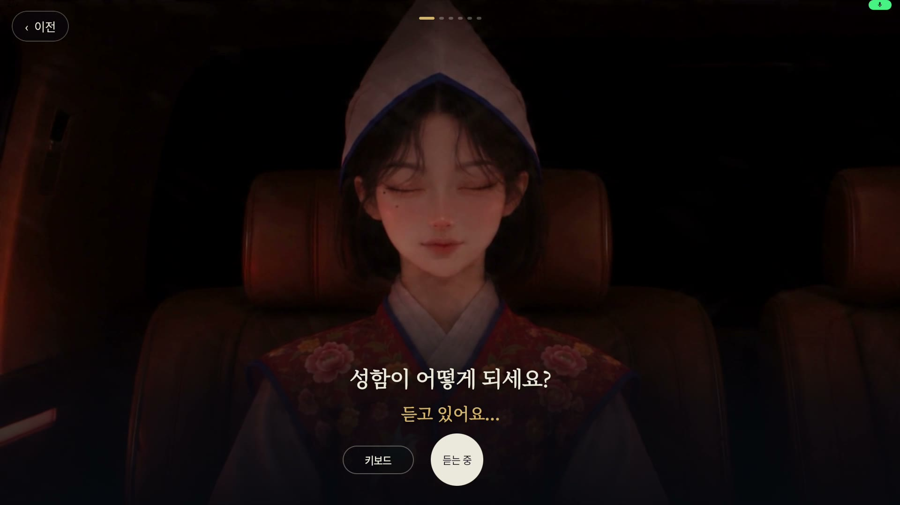
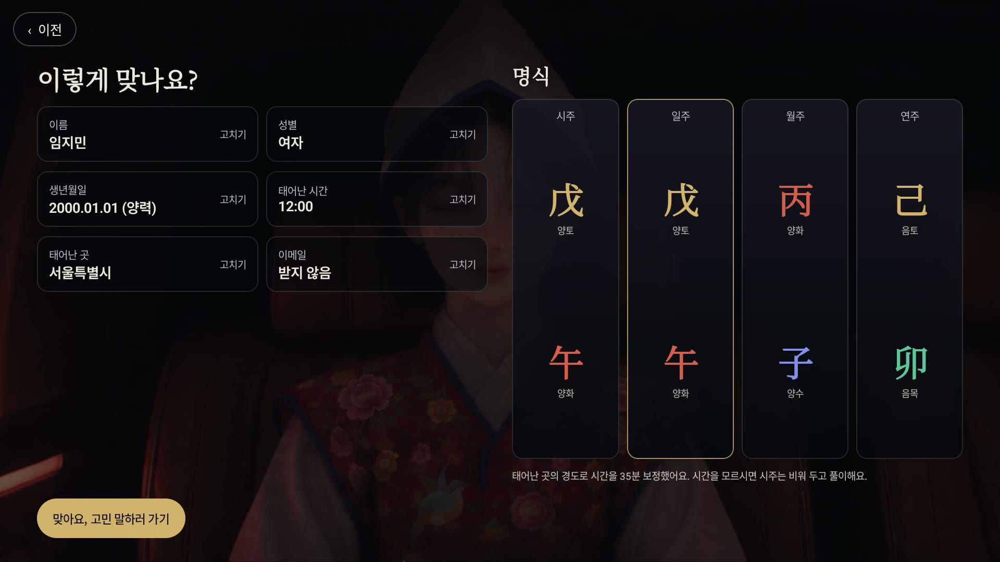
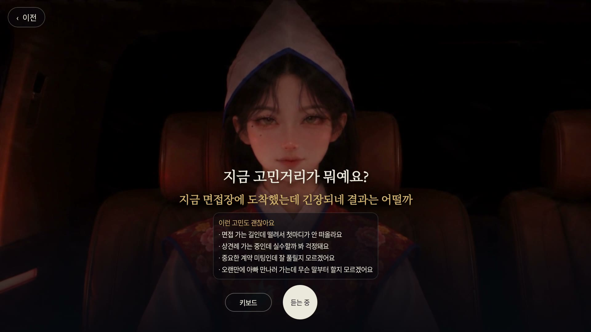
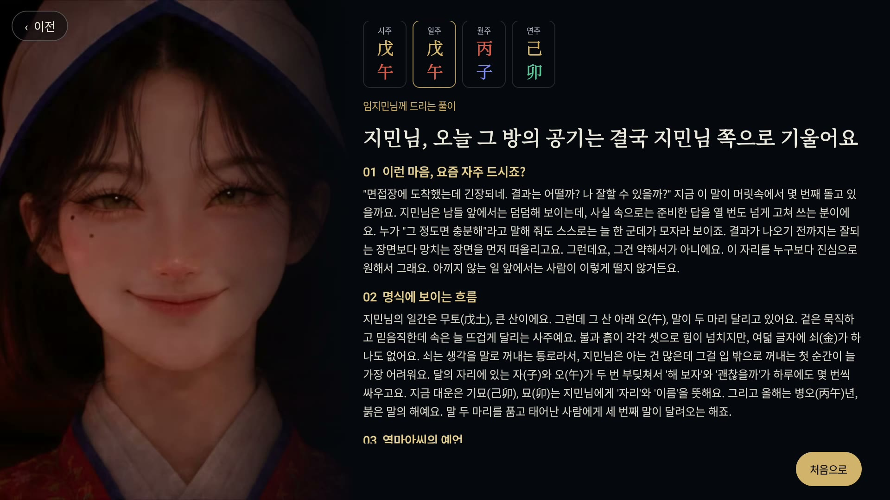
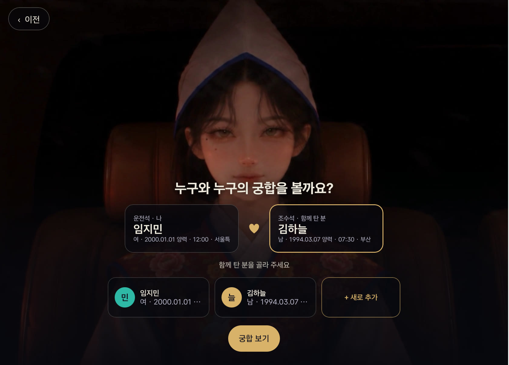
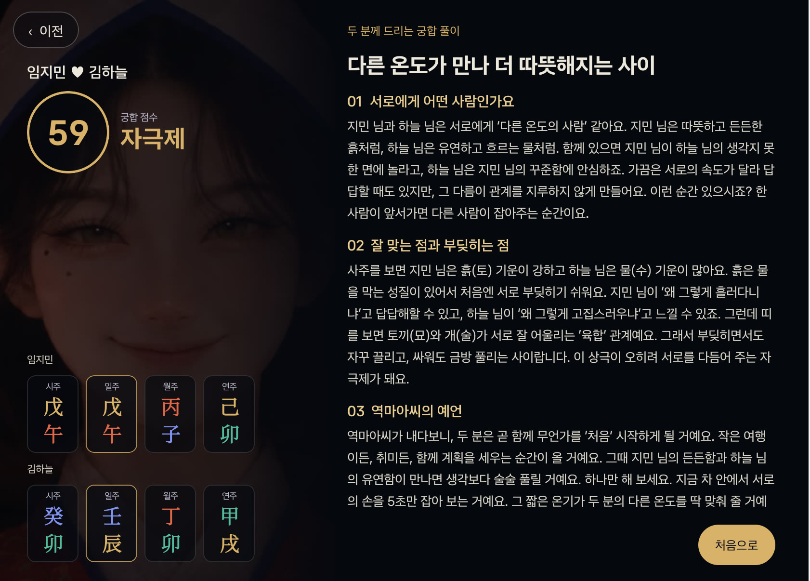
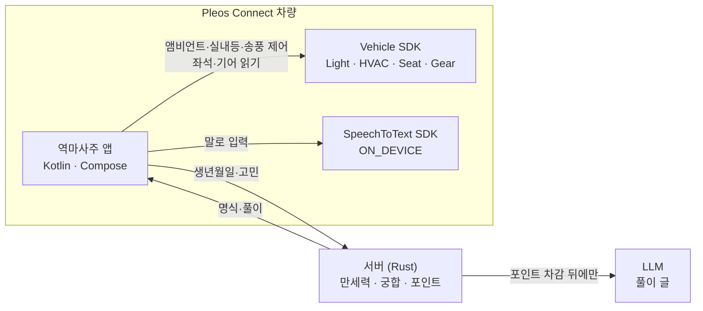

<p align="center">
  
</p>

<h1 align="center">역마사주 (Yeokma Saju) 상세 README</h1>

<p align="center">팀 tridrive</p>

<p align="center"><b>중요한 일정을 앞두고, 출발 전이나 도착 후 차 안에서 보내는 몇 분. 그 시간의 고민을 사주로 풀어 주는 차량용 사주 앱</b></p>

<p align="center">
  <a href="#해결하려는-문제">해결하려는 문제</a> ·
  <a href="#왜-차인가-몰입에는-차가-가장-중요한-환경입니다">왜 차인가</a> ·
  <a href="#실행-방법">실행 방법</a> ·
  <a href="#apk">APK</a> ·
  <a href="#시연-영상">시연 영상</a> ·
  <a href="기획서.md">기획서 (시나리오 · 개발 계획 · 기대효과 · 참고자료)</a>
</p>

중요한 일정이 있는 날에는 출발하기 전이나 도착한 뒤, 차 안에서 몇 분을 보내게 됩니다. 혼자 있을 수 있는 거의 유일한 공간이지만, 마음은 가장 불안한 때입니다. 역마사주는 그 몇 분을 위한 앱입니다.

앱을 열면 숲길을 달려온 차의 문이 열리고 역마아씨가 기다립니다. "탑승하기"를 누르는 순간 내 차의 앰비언트 라이트가 무드등 색으로 바뀌고 실내등이 켜지며, 송풍이 잔잔하게 흘러 영상 속 장면이 그대로 내 차 안으로 이어집니다. 지금의 고민을 말로 털어놓으면 역마아씨가 내 사주로 풀어 주고, 풀이를 기다리는 동안 무드등은 오행의 색으로 천천히 바뀝니다. 차는 화면이 달린 공간이 아니라, 중요한 자리에 들어가기 전 마음을 다잡게 해 주는 몰입 장치가 됩니다.

Pleos Connect(안드로이드 오토모티브) 차량용 앱입니다.

## 해결하려는 문제

중요한 일정을 앞둔 운전자는 출발 전이나 도착 후 차 안에서 혼자 긴장을 삭이는 몇 분을 보냅니다. 누군가에게 털어놓기엔 애매하고, 휴대폰 운세 앱은 오늘의 띠별 운세처럼 넓은 이야기만 하고 지금 이 고민에는 답하지 않습니다. 역마사주는 그 몇 분 동안 차 안 전체를 상담 공간으로 바꿔, 지금의 고민을 내 사주로 풀어 줍니다.

국내 성인 1,000명 조사에서 25.1%가 "중요한 일이나 결과를 기다릴 때" 운세를 본다고 답했고, 84.4%는 운세가 마음의 위안이 된다고 했습니다([출처](https://www.openads.co.kr/content/contentDetail?contsId=2344)). 사주·타로를 본 이유로는 시험·취업·이직 같은 진로 문제가 24%로 꼽혔습니다([출처](https://hrcopinion.co.kr/archives/20672)). 자세한 근거는 [기획서 2번](기획서.md#2-기획-배경)에 있습니다.

| | 휴대폰 운세 앱 | 범용 AI 챗봇 | 역마사주 |
|---|---|---|---|
| 언제 쓰나 | 아무 때나 | 아무 때나 | 중요한 일정을 앞둔 출발 전·도착 후의 몇 분 |
| 무엇에 답하나 | 띠별·오늘의 운세 | 묻는 대로 | 내 명식과 지금 말한 고민을 함께 |
| 사주 계산 | 앱마다 다름 | 계산 근거가 없음 | 서버가 직접 계산(진태양시, 절기, 대운 등) |
| 어디서 겪나 | 손안의 작은 화면 | 텍스트 | 차 디스플레이·스피커·앰비언트 라이트·실내등·송풍 |
| 입력 | 키보드 양식 | 키보드 | 질문에 말로 답하기 |
| 함께 탄 사람 | 모름 | 모름 | 좌석 센서로 알아채 궁합으로 연결 |
| 안전 | 해당 없음 | 해당 없음 | 기어가 P일 때만 열림, 주행 중 잠금 |

## 왜 차인가: 몰입에는 차가 가장 중요한 환경입니다

사주 풀이가 마음에 닿으려면 듣는 사람이 그 순간에 온전히 빠져들어야 합니다. 휴대폰은 손안의 작은 화면뿐이고 알림과 주변 소음에 쉽게 끊깁니다. 차는 다릅니다. 문을 닫으면 바깥과 분리된 나만의 공간이 되고, 화면·스피커·빛·바람이 몸 전체를 감쌉니다. 역마사주는 이 차 안을 통째로 역마아씨의 상담 공간으로 바꿉니다. **이 몰입은 차 안에서만 만들 수 있습니다.**

| 근거 | 내용 |
|---|---|
| 사람들은 이미 차 안에서 마음을 준비한다 | 운전자 2,000명 조사에서 26%가 집이나 직장에 들어가기 전 마음을 준비하려고 차 안에서 시간을 보내고, 77%가 출발·도착 전후의 "카타임"을 즐긴다고 답했습니다[1]. 다른 조사에서는 63%가 차 안에서 5분 쉬고 나면 하루를 더 잘 준비한다고 느꼈습니다[2]. 국내 조사에서도 혼자만의 공간이 필요할 때 떠올리는 곳으로 자동차가 꼽혔습니다(16.9%)[3] |
| 차 안의 빛은 감정을 움직인다 | 차량 실내조명의 색을 바꾸면 뇌파로 측정한 각성도가 달라졌고[4], 앰비언트 조명을 켜면 운전자의 수행이 나아졌습니다[5]. 운전자의 감정에 맞춰 조명을 바꿔 스트레스를 낮추는 연구도 진행되고 있습니다[6] |
| 차는 감각 전체를 한꺼번에 바꿀 수 있는 유일한 개인 공간이다 | 고급차 브랜드는 이미 공조·향기·시트 마사지·음악·앰비언트 조명을 묶어 기분을 바꾸는 프로그램을 판매하고 있습니다[7]. 현대차그룹도 플레오스 커넥트 앱 마켓을 게임·엔터테인먼트 앱으로 넓힐 계획입니다[8] |
| 플레오스가 가려는 방향과 맞는다 | 역마사주는 차 기능을 함께 움직여 몰입을 만드는 차량 전용 엔터테인먼트 앱입니다. 앱 마켓이 엔터테인먼트로 넓어질 때 휴대폰 앱을 옮겨 온 것이 아니라 **차에서만 할 수 있는 콘텐츠**가 필요하고, 역마사주는 그 첫 사례가 될 수 있습니다. 중요한 일정이 생길 때마다 다시 여는 이유가 있어 앱 마켓의 재방문도 만듭니다 |

역마사주는 이 근거 위에서 차의 디스플레이·스피커(탑승 영상과 인사), 앰비언트 라이트·실내등(장면마다 바뀌는 빛), 송풍(잔잔한 바람), 좌석 센서(함께 탄 사람)를 하나의 장면으로 묶습니다. **이 빛과 바람, 소리는 단순한 연출이 아니라 사용자가 풀이에 빠져들게 만드는 핵심 몰입 요소입니다.**

<sub>출처: [1](https://www.halfordscompany.com/news-and-media/news/brits-spend-half-a-day-a-year-in-their-cars-searching-for-peace-and-quiet/) 영국 운전자 조사(업체 의뢰), [2](https://www.nova.ie/motorists-spend-more-than-three-days-of-their-lives-looking-for-their-cars/) 아일랜드 운전자 조사, [3](https://www.openads.co.kr/content/contentDetail?contsId=1579) 국내 소비자 조사, [4](https://deepai.org/publication/affective-responses-to-chromatic-ambient-light-in-a-vehicle) Kim 외(2022), [5](https://dl.ifip.org/IFIP-LNCS-11746/hal-02544538) Hassib 외(INTERACT 2019), [6](https://openaccess.cms-conferences.org/publications/book/978-1-958651-15-5/article/978-1-958651-15-5_47) AHFE 2022, [7](https://www.mercedes-benz.co.nz/passengercars/brand/mercedes-me-magazine/innovation/articles/ergonomic-design-driving-comfort.html) 제조사 기능 소개, [8](https://www.hyundaimotorgroup.com/en/news/hyundai-motor-group-redefines-in-vehicle-experience-with-pleos-connect-next-generation-infotainment-system) 현대차그룹 발표</sub>

## 실행 방법

### 폴더

| 폴더 | 내용 |
|---|---|
| `app/` | 차량 앱. Kotlin, Jetpack Compose, Media3, Pleos Vehicle SDK 2.3.2, Pleos SpeechToText SDK 3.3.1 |
| `server/` | 서버. Rust. 이 컴퓨터에서 로컬로 실행하고, 포인트는 로컬 DB에 저장합니다 |
| `data/` | 태어난 곳 목록(전국 특별시·광역시와 시·군). 앱과 서버가 같이 씁니다 |

### 준비물

| 항목 | 버전 | 필요한 때 |
|---|---|---|
| Android Studio | 2026.2 이상 (명령줄 빌드에는 Android Studio에 들어 있는 JDK를 씁니다) | 앱 |
| Pleos 에뮬레이터 | Android SDK의 `pleos_car_emulator` 이미지 v2.1.0, 가상 기기 2560×1440 | 앱 |
| Rust | 1.100 이상 (`rustup`) | 서버 |
| Node.js | 24 이상 (`npx wrangler`) | 서버 |

### 1. 앱 설치와 실행

**서버를 켜지 않아도 앱은 끝까지 동작합니다.** 서버에 연결되지 않으면 앱 안의 목업 풀이(태어난 달의 계절 기운으로 쓴 풀이)가 나오고, 복채(포인트) 화면은 건너뜁니다. 정밀 만세력, 포인트, LLM 풀이를 보려면 2번의 서버를 켭니다.

#### 바로 설치 (빌드된 APK)

저장소의 [`apk/tridrive_yeokmasaju_release.apk`](../apk/tridrive_yeokmasaju_release.apk)를 설치합니다. [Releases](https://github.com/hyndai-contest-team/yeokma-saju/releases/latest)에도 같은 파일이 있습니다. 빌드 없이 바로 됩니다.

```bash
export ANDROID_HOME="$HOME/Library/Android/sdk"

# 저장소 루트에서, 에뮬레이터를 켠 뒤 설치하고 실행합니다
$ANDROID_HOME/platform-tools/adb install -r --user 10 apk/tridrive_yeokmasaju_release.apk
$ANDROID_HOME/platform-tools/adb shell am start --user 10 -n com.yeokma.saju/.MainActivity
```

#### 직접 빌드해서 설치

```bash
export JAVA_HOME="/Applications/Android Studio.app/Contents/jbr/Contents/Home"
export ANDROID_HOME="$HOME/Library/Android/sdk"

# 에뮬레이터 켜기
$ANDROID_HOME/emulator/emulator -avd Pleos_Connect_v2.1.0 -no-snapshot-load &
$ANDROID_HOME/platform-tools/adb wait-for-device

# 빌드
cd app
./gradlew :app:assembleDebug

# 설치와 실행: Pleos 차량 화면은 사용자 10번이라 --user 10이 필요합니다
$ANDROID_HOME/platform-tools/adb install -r --user 10 app/build/outputs/apk/debug/app-debug.apk
$ANDROID_HOME/platform-tools/adb shell am start --user 10 -n com.yeokma.saju/.MainActivity
```

Android Studio에서는 `app/` 폴더를 열고 실행해도 됩니다.

- 앱은 서버를 `http://10.0.2.2:8787`(에뮬레이터에서 본 이 컴퓨터)로 찾습니다.
- 음성 입력은 Pleos SpeechToText SDK(3.3.1)의 `ON_DEVICE` 모드를 씁니다. 차 안의 인식 엔진이라 앱 등록 키가 필요 없습니다. Pleos 인식 엔진이 없는 기기에서는 안드로이드 기본 음성 인식기로, 그것도 없으면 키보드로 입력합니다.
- 공조 풍량·풍향 제어는 에뮬레이터가 지원하지 않아 실차에서만 동작합니다.

### 2. 서버 켜기 (선택)

정밀 만세력, 포인트, LLM 풀이를 보려면 이 컴퓨터에서 서버를 켭니다. Rust가 설치되어 있지 않다면 먼저 [Rust 설치 방법(macOS)](rust-install-macos.md)을 따라 설치합니다.

```bash
cd server

# 처음 한 번
npx wrangler@4.162.0 d1 migrations apply yeokma-saju --local   # 로컬 포인트 DB 만들기

# (선택) LLM 키. 넣지 않으면 서버의 목업 풀이(실제 만세력으로 쓴 풀이)가 나옵니다
echo 'OPENROUTER_API_KEY="sk-or-..."' > .dev.vars

# 서버 실행 (에뮬레이터에서 붙을 수 있게 0.0.0.0)
npx wrangler@4.162.0 dev --ip 0.0.0.0 --port 8787
```

`http://127.0.0.1:8787/` 에서 `yeokma-saju api`가 보이면 켜진 것입니다.

- `.dev.vars`는 깃에 올라가지 않습니다. 키를 레포나 앱에 넣지 마세요.
- LLM 모델은 `wrangler.toml`의 `MODEL` 값 하나로 바꿉니다. 기본값은 `deepseek/deepseek-v4.1-flash-1017`(OpenRouter)입니다.
- 만세력 테스트: `cargo test --lib`

#### API

| 경로 | 하는 일 |
|---|---|
| `POST /api/manse` | 만세력 계산 |
| `GET /api/wallet?device=` | 포인트 잔액 |
| `POST /api/charge` | 포인트 충전. 시연용이라 결제 인증 없이 바로 충전됩니다 (990원 1회 / 9,900원 11회 / 99,000원 115회) |
| `POST /api/reading` | 990P를 먼저 빼고 풀이를 만듭니다. 포인트가 모자라면 402를 돌려주고 LLM을 부르지 않습니다 |
| `POST /api/match` | 두 사람의 궁합. 같은 방식으로 990P를 먼저 빼고 점수와 풀이를 만듭니다 |

## 테스트 환경 및 필요한 설정

| 설정 | 방법 |
|---|---|
| 에뮬레이터 실행 | Cold boot로 켠다(`-no-snapshot-load`). Quick boot로 켜면 차량 신호를 쓸 수 없다 |
| 설치·실행 사용자 | Pleos 차량 화면은 사용자 10번이다. `adb install --user 10`, `adb shell am start --user 10`처럼 `--user 10`을 붙인다 |
| 권한 | 차량 권한(`CAR_LIGHTS`, `CONTROL_CAR_LIGHTS`, `CAR_CLIMATE`, `CONTROL_CAR_CLIMATE`, `CAR_SEATS`, `CAR_DRIVE`, `STT_SERVICE`)은 설치하면 허용된다. 마이크 권한은 첫 음성 입력 때 묻는다 |
| 음성 입력 | Mac 마이크가 에뮬레이터에 들어가야 한다. 기본으로 켜져 있고, 안 되면 에뮬레이터 Extended controls → Microphone에서 "Virtual microphone uses host audio input"을 켠다. 키보드로도 입력할 수 있다 |
| 서버 | 없어도 앱은 끝까지 동작한다(앱 안 목업 풀이). 명식, 포인트, 궁합, LLM 풀이를 보려면 아래 "서버 켜기"대로 로컬 서버를 켠다. 앱은 `http://10.0.2.2:8787`로 찾는다 |
| 동승 궁합 | Virtual Console에서 조수석이나 뒷좌석을 "Occupied"로 바꾼 뒤 앱을 연다. `adb forward tcp:8088 tcp:8088` 후 `http://127.0.0.1:8088/` → Emulation Controls → Seat Occupancy |
| 앰비언트·실내등 확인 | Virtual Console의 Ambient 화면에서 앱이 바꾼 색과 실내등 상태를 볼 수 있다 |
| 처음 상태로 되돌리기 | `adb shell pm clear --user 10 com.yeokma.saju` (저장된 사람과 기기 번호가 지워진다) |
| 주행 중 잠금 | Virtual Console의 Test Console에서 기어를 D로 바꾸면 앱이 잠기고, P로 돌리면 보던 화면과 그 화면의 조명·공조가 이어진다. 기어 신호가 없는 일반 안드로이드 에뮬레이터에서는 잠그지 않는다 |
| 알려진 한계 | 공조 풍량·풍향은 에뮬레이터가 지원하지 않아 실차에서만 동작한다 |

테스트용 입력 예: 이름 "임지민", 성별 "여자", 생년월일 "2000년 1월 1일", 태어난 시간 "12시", 태어난 곳 "서울", 고민 "지금 면접장에 도착했는데 긴장되네. 나 잘할 수 있을까?". LLM 키 없이 서버를 켜면 이 사람에게는 시연용 풀이가 나온다.

## 개발 환경: Pleos Connect 에뮬레이터 버전과 화면 규격

| 항목 | 값 |
|---|---|
| 에뮬레이터 | Pleos Connect Emulator **v2.1.0** (Android Studio 시스템 이미지 `pleos_car_emulator`, arm64-v8a) |
| 안드로이드 | Android 14 (API 34) |
| 가상 기기(AVD) | `Pleos_Connect_v2.1.0`, Automotive, RAM 4GB, Cold boot |
| 화면 | **2560×1440**, 160dpi, 가로 |
| 앱이 그려지는 영역 | 차량 화면 오른쪽 칸, 약 1682×1206px (사용자 10번 화면) |
| 앱 설정 | `minSdk 34`, `targetSdk 34`, `compileSdk 37`, 가로 고정. 차량 화면에서 잘 보이게 UI를 1.45배로 키워 그린다 |
| 개발 PC | macOS, Apple Silicon (Pleos 에뮬레이터 이미지가 arm64라 Apple Silicon Mac에서 실행) |
| 시연 영상 녹화 | 앱을 전체 화면으로 담으려고 1920×1080 일반 안드로이드 에뮬레이터(Android API 37)에서 녹화. 동승 궁합 화면은 Pleos 에뮬레이터에서 촬영 |

## APK

| 항목 | 내용 |
|---|---|
| 저장소 안 위치 | [`apk/tridrive_yeokmasaju_release.apk`](../apk/tridrive_yeokmasaju_release.apk) |
| GitHub Release | [최신 릴리스](https://github.com/hyndai-contest-team/yeokma-saju/releases/latest) |
| 파일 정보 | 패키지 `com.yeokma.saju`, 버전 0.1.0, 릴리스 빌드(코드 축소), 시연용 디버그 키 서명, 약 67MB |
| 직접 빌드한 경우 | `./gradlew :app:assembleRelease` → `app/app/build/outputs/apk/release/app-release.apk` |

## 시연 영상

https://github.com/user-attachments/assets/76b15628-df0b-4d45-a509-7a91ebe3bafa

시연용 영상입니다.

## 핵심 화면

### 사주 보기

<table>
  <tr>
    <td align="center" width="33%"><br><b>01 인트로 대기</b><br><sub>세로 한자와 함께 탑승을 기다립니다</sub></td>
    <td align="center" width="33%"><br><b>02 오셨군요</b><br><sub>저장된 사람을 고르거나 새로 추가</sub></td>
    <td align="center" width="33%"><br><b>03 말로 입력</b><br><sub>이름부터 태어난 곳까지 음성으로</sub></td>
  </tr>
  <tr>
    <td align="center" width="33%"><br><b>04 확인과 명식</b><br><sub>서버가 계산한 사주 여덟 글자</sub></td>
    <td align="center" width="33%"><br><b>05 지금 고민</b><br><sub>고민을 말로 털어놓습니다</sub></td>
    <td align="center" width="33%"><br><b>06 복채</b><br><sub>풀이 한 번 990P</sub></td>
  </tr>
  <tr>
    <td align="center" width="33%"><br><b>07 풀이 대기</b><br><sub>무드등이 오행 색으로 바뀝니다</sub></td>
    <td align="center" width="33%"><br><b>08 리포트</b><br><sub>명식과 역마아씨의 예언</sub></td>
    <td width="33%"></td>
  </tr>
</table>

### 동승 궁합

<table>
  <tr>
    <td align="center" width="33%"><br><b>09 혼자가 아니시군요?</b><br><sub>좌석 센서로 동승자 감지</sub></td>
    <td align="center" width="33%"><br><b>10 두 사람 고르기</b><br><sub>운전석과 함께 탄 분</sub></td>
    <td align="center" width="33%"><br><b>11 궁합 결과</b><br><sub>점수, 유형, 두 사람의 명식</sub></td>
  </tr>
</table>

## 기능

휴대폰과 다른 점은 사용자를 둘러싼 실제 공간까지 앱에 참여한다는 것입니다. 디스플레이에 역마아씨가 나타나고, 차량 스피커로 인사가 들리고, 앰비언트 라이트·실내등·송풍이 같은 장면을 함께 만듭니다. 차량 기능은 화면을 꾸미는 단순한 연출이 아니라, 상담 공간에 들어와 있다고 느끼게 하는 **중요한 몰입 요소**입니다.

| 구분 | 핵심 내용 |
|---|---|
| 주행 중 잠금 | 기어가 P(주차)일 때만 쓸 수 있습니다. P를 벗어나면 화면을 잠그고 영상·소리·음성 입력을 멈추며, 바꿔 둔 조명과 공조를 바로 되돌립니다. 다시 P에 두면 보던 화면과 그 화면의 조명·공조가 이어집니다. 기어 값을 알 수 없으면 잠급니다 |
| 앰비언트 라이트 · 실내등 | 대기 화면에서 무드등 금색과 실내등 켜기, 탑승 5초에 실내등 끄고 6초에 붉은빛, 풀이를 기다리는 동안 오행 색으로 순환 |
| 송풍 | 사용자가 맞춰 둔 온도·에어컨·풍향은 그대로 두고 풍량만 "중"으로 맞춘 잔잔한 바람. 앱을 떠나면 원래 풍량으로 |
| 동승 궁합 | 좌석 센서로 동승자를 감지하면 "혼자가 아니시군요?"로 사주 보기와 궁합 보기를 나눔. 두 사람의 명식으로 점수(38\~97)와 유형(귀인, 단짝, 동반자, 자극제, 숙제) |
| 디스플레이 · 스피커 | 숲길을 달려온 차와 역마아씨의 탑승 영상, 차량 스피커로 들리는 "오셨군요" 인사 |
| 음성 입력 | 이름, 성별, 생년월일, 태어난 시간("오후 한 시 반"), 태어난 곳(전국 시·군)을 질문에 따라 말로 입력. 키보드도 지원 |
| 명식 | 서버가 직접 계산한 사주 여덟 글자를 확인 화면과 리포트에 표시(절기, 음력·윤달, 진태양시, 한국 표준시·서머타임 이력, 대운, 십신, 지장간, 12운성, 공망, 합충) |
| 지금 고민 풀이 | 매번 "지금 고민거리가 뭐예요?"를 새로 묻고, 명식과 그날의 고민을 함께 반영해 제목과 소제목 3개로 풀이. 마지막은 "역마아씨의 예언" |
| 저장된 사람 | 최대 5명까지 저장. 다시 오면 고르기만 하고 바로 고민으로 넘어가 일정 전의 짧은 시간을 아낍니다 |
| 평소 설정으로 복귀 | 연출 전에 기존 값을 저장해 두고, 앱을 떠나면 앰비언트 라이트·실내등·공조를 원래대로 되돌림 |

## 차량 특화 기능과 사용 SDK

| 기능 | 하는 일 | SDK · API | 권한 | 코드 |
|---|---|---|---|---|
| 앰비언트 라이트 | 대기 화면에서 무드등 금색, 탑승 6초에 붉은빛, 풀이를 기다리는 동안 오행 색으로 바뀜 | Pleos Vehicle SDK 2.3.2 `Light`: `checkAmbientLightBrightnessColorCapabilities`, `getAmbientLightBrightnessColor`, `setAmbientLightBrightnessColor` | `CAR_LIGHTS`, `CONTROL_CAR_LIGHTS` | [CarMood.kt `ambient`](../app/app/src/main/java/com/yeokma/saju/car/CarMood.kt#L112), [오행 순환](../app/app/src/main/java/com/yeokma/saju/ui/ReadingScreens.kt#L128) |
| 실내등 | 대기 화면에서 켜고, 탑승 5초에 끔 | Vehicle SDK `Light`: `getCabinLightSwitch`, `setCabinLightSwitch` | `CAR_LIGHTS`, `CONTROL_CAR_LIGHTS` | [CarMood.kt `cabin`](../app/app/src/main/java/com/yeokma/saju/car/CarMood.kt#L125), [탑승 5초](../app/app/src/main/java/com/yeokma/saju/intro/IntroFlow.kt#L107) |
| 송풍 | 공조 전원을 켜고 풍량만 "중"으로. 온도·에어컨·풍향은 사용자 설정 그대로(AUTO는 풍량을 맞추려고 잠시 끔) | Vehicle SDK `HVAC`: `setHvacPower`, `setHvacAuto`, `setHvacFanSpeed` (각각 `check…Capabilities`, `get…`로 지원 범위와 원래 값을 읽어 두고 되돌림) | `CAR_CLIMATE`, `CONTROL_CAR_CLIMATE` | [CarMood.kt `breeze`](../app/app/src/main/java/com/yeokma/saju/car/CarMood.kt#L135) |
| 주행 중 잠금 | 기어가 P가 아니면 화면을 잠그고 영상·소리·음성 입력을 멈춤, 조명·공조 복원 | Vehicle SDK `Gear`: `getCurrentGearSelectionState`, `registerGearSelection` | `CAR_DRIVE` | [CarMood.kt 기어 구독](../app/app/src/main/java/com/yeokma/saju/car/CarMood.kt#L52), [잠금 화면](../app/app/src/main/java/com/yeokma/saju/SajuApp.kt#L315) |
| 동승자 감지 | 운전석 말고 앉은 자리가 있으면 "혼자가 아니시군요?"로 궁합 보기를 엶 | Vehicle SDK `Seat`: `checkSeatOccupancyCapabilities`, `getCurrentSeatOccupancy` | `CAR_SEATS` | [CarMood.kt `companions`](../app/app/src/main/java/com/yeokma/saju/car/CarMood.kt#L63) |
| 음성 입력 | 이름, 성별, 생년월일, 시간, 태어난 곳, 고민을 말로 입력 | Pleos SpeechToText SDK 3.3.1 (`ON_DEVICE` 모드): `initialize`, `setLocale(Locale.KOREA)`, `addListener`, `request`, `stop`. Pleos가 아닌 기기에서는 안드로이드 `SpeechRecognizer`로 대체 | `STT_SERVICE` | [Voice.kt](../app/app/src/main/java/com/yeokma/saju/input/Voice.kt#L39) |

권한은 모두 `pleos.car.permission.` 아래 이름입니다. 바꾼 조명과 공조는 앱을 떠날 때 원래 값으로 되돌립니다.

### 구조




## 사업성

| 근거 | 내용 |
|---|---|
| 시장 | 국내 점술 시장 약 **1조 4,000억 원** 추산(스타트업 분석 업체 추산, 2024) |
| 이미 검증된 앱 수요 | 대표 운세 앱 한 곳의 누적 다운로드 **1,700만 건**, 다른 한 곳의 가입자 **750만 명**(2026) |
| 폭넓은 고객층 | 성인 응답자의 **56.4%**가 사주 서비스를 이용해 본 경험이 있음(리서치 업체 조사). AI 사주 이용층은 30·40대 남성까지 넓어지는 중(2026). 중요한 일정을 앞둔 운전자라면 연령과 상관없이 고객입니다 |
| AI 사주의 급성장 | 한 AI 사주 앱의 월매출 **1천만 원대(2024) → 10억 원(2025)**, 월 이용자 **100만 명** 돌파(2026.08). 운세 앱 월 이용자 상위 10개 중 **6개가 AI 기능**을 갖춤(앱 분석 업체 집계, 2026) |
| 차별화가 필요한 이유 | 범용 AI 챗봇으로 운세를 보는 사람이 늘면서 텍스트 위주의 기존 운세 앱은 월 이용자가 전년보다 줄었음(대표 운세 앱 두 곳, 2026.01) |
| 역마사주의 자리 | 화면 속 텍스트로는 따라 할 수 없는 **차 안의 몰입 경험**(빛·바람·소리)과 **중요한 일정을 앞둔 출발 전·도착 후**라는 분명한 사용 순간. 중요한 일정이 생길 때마다 다시 여는 이유가 됩니다 |
| 플랫폼 방향 | 현대차그룹은 2030년까지 플레오스 커넥트 탑재 차량 약 2,000만 대를 확보하고 앱 마켓을 게임·엔터테인먼트로 넓힐 계획입니다. 역마사주는 그 엔터테인먼트 영역에 들어갈 차량 전용 콘텐츠입니다 |
| 수익 모델 | 풀이 1회 990P(990원). 9,900원 11회, 99,000원 115회 묶음. 동승 궁합도 같은 가격 |

예상 MAU(2030년 국내 기본 약 8,600명, 낙관 약 3만 1,500명), 재이용률 기준치, 수수료·LLM 비용을 뺀 순수익 계산은 [기획서 6번 기대효과](기획서.md#6-기대효과-및-발전-가능성)에 있습니다.

<sub>출처: [1](https://www.hankyung.com/article/2026021070861), [2](https://v.daum.net/v/20250909112824410), [3](https://blog.hanabank.com/501979), [4](https://v.daum.net/v/20260213173831600), [5](https://www.sedaily.com/article/20078817), [6](https://m.etnews.com/20260807000281), [7](https://www.kmjournal.net/news/articleView.html?idxno=8593), [8](https://www.sentv.co.kr/article/view/sentv202610230113)</sub>
